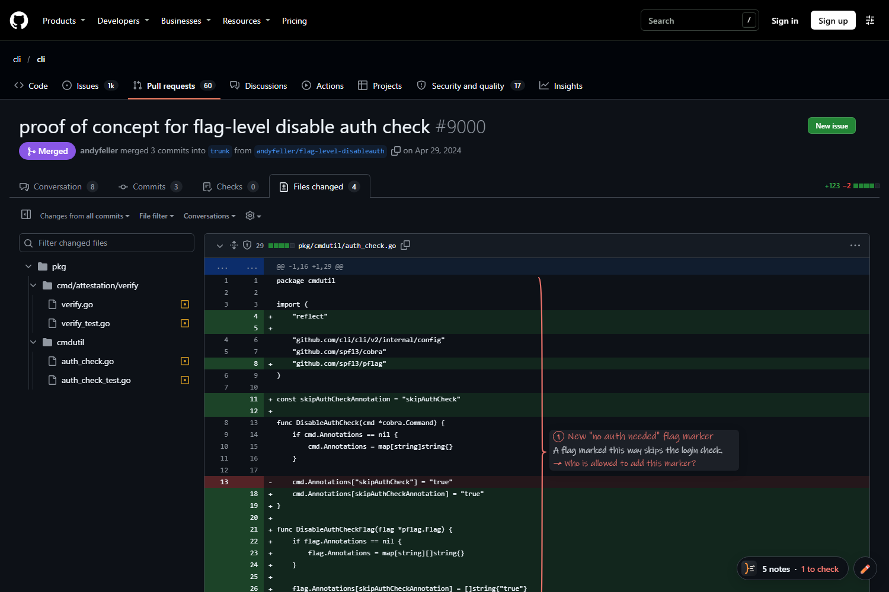

<p align="center">
  
</p>

<h1 align="center">PR Explainer</h1>

<p align="center">
  Short handwritten notes, right on the code of your GitHub pull requests.<br>
  Review faster, and actually understand what every piece of the change does.
</p>

<p align="center">
  
</p>

## Why

Code review is becoming the slow part of the job: more code gets written, and someone still has to understand it.
PR Explainer reads the pull request for you and writes a few words in the margin of each change, like a colleague
with a pencil. You stay in charge of the review, you just get there faster.

## Features

- **Margin notes on the diff.** Each changed block gets a hand-drawn brace and a 3–8 word note.
  Click a note to see *why* in one sentence, and the question worth asking, if any.
- **Colour = attention.** Green is mechanical (renames, moves), orange is logic worth reading,
  red is sensitive (security, permissions, data, migrations).
- **Reading order.** The panel lists the notes in the order that makes the PR easiest to follow.
- **Circle and ask.** Use the pencil to circle code (or draw an arrow between two places) and ask a question.
  The answer is written next to it.
- **Knows your project.** If the repository is cloned on your machine, the AI can read the surrounding code
  (callers, conventions) to explain the change better. Found automatically.
- **Your own subscription.** Uses **Claude** (Pro, Max, Team, Enterprise) or **ChatGPT** (Plus, Pro, Team, Enterprise)
  through their official command-line tools. No API key, nothing to pay on top.
- **English or French**, for the interface and the notes.

## Install (Windows)

1. Click **Code → Download ZIP** on this page and **extract** it to a folder you will keep,
   for example `C:\Tools\pr-explainer` (not inside Downloads or a temporary folder).
2. Double-click **`Install.cmd`**. It checks what is needed, offers to install what is missing,
   and signs you in to GitHub and to Claude or ChatGPT in your browser.
3. Your browser opens on its extensions page. Turn on **Developer mode**, click **Load unpacked**
   and pick the `extension` folder (its path is already in your clipboard).

That's it. Open a pull request on GitHub, **Files changed** tab: notes appear on their own.
The first analysis of a PR takes 1–2 minutes, then it is instant until new commits are pushed.

Works with Google Chrome, Microsoft Edge and Brave.

> Running `Install.cmd` again is safe: it repairs or updates the setup. Run it again if you move the folder.

### What the installer does

- Uses or installs, **after asking**: [Node.js](https://nodejs.org) 18+ and [GitHub CLI](https://cli.github.com) (via `winget`),
  and [Claude Code](https://github.com/anthropics/claude-code) (official script) or [Codex](https://github.com/openai/codex) (`npm`).
  An existing Codex from the Codex desktop app or the ChatGPT extension of VS Code is found and reused.
- Writes a small launcher and its manifest to `%LOCALAPPDATA%\PR Explainer`.
- Registers it for the browsers under `HKCU\Software\…\NativeMessagingHosts` (your user only, no admin rights).
- Runs a self-check and opens the extensions page.

## Settings

Click the PR Explainer icon in the browser toolbar:

| Setting | |
|---|---|
| **Status** | GitHub, Claude and ChatGPT connection state |
| **AI subscription** | Auto (whichever is connected), Claude or ChatGPT |
| **Language** | Auto (browser language), English or Français |
| **Annotate when a PR opens** | Analyse automatically, or only when you click *Annotate this PR* |
| **Show notes on the code** | Hide the margin notes and keep only the list |
| **Hide mechanical notes** | Only keep notes worth reading |
| **Let the AI read my local project** | Turn off to send the diff only |
| **Advanced** | Point a repository to a folder if auto-detection misses it, clear saved analyses |

## How it works

```
GitHub page ──► Extension ──► Local helper (host/host.js) ──► gh (reads the PR)
  (notes)                         (native messaging)        └► claude -p  or  codex exec
                                                                (read-only, in your local clone)
```

The extension only draws on the page. A small Node.js helper, started by the browser through
[native messaging](https://developer.chrome.com/docs/extensions/develop/concepts/native-messaging),
fetches the PR with the GitHub CLI and asks the AI tool installed on your machine.

## Privacy and security

- **No server of ours.** Nothing goes anywhere except GitHub (through your `gh` login) and your AI provider
  (through your own Claude Code or Codex login), exactly as if you ran those tools yourself.
- **Read-only AI.** Claude Code runs with the `Read`, `Grep` and `Glob` tools only; Codex runs in its `read-only` sandbox.
  Neither can edit files or run commands that change anything.
- **Only this extension can talk to the helper** (`allowed_origins` in the native messaging manifest). The helper
  validates every request, and page content only reaches the AI through its standard input, never a command line.
- **Local data** (saved analyses, a small log without code) lives in `%LOCALAPPDATA%\PR Explainer`.
  Clear it from the settings or with `Uninstall.cmd`.
- The AI provider's own terms apply to what you send it. Turn off *Let the AI read my local project*
  if you only want the diff to be shared.

## Uninstall

Double-click **`Uninstall.cmd`**, then remove the extension from your browser's extensions page.

## Troubleshooting

| Problem | Fix |
|---|---|
| "The local helper is not installed" | Run `Install.cmd` (again if you moved the folder). |
| The settings show *not connected* | Run `Install.cmd` again to sign in. |
| A note says *not shown* | The file is collapsed or not loaded yet by GitHub: expand it or scroll down. |
| "Developer mode" is blocked | Your company policy forbids unpacked extensions: ask your IT team. |
| Anything else | Look at `%LOCALAPPDATA%\PR Explainer\host.log`. |

From a terminal, `node host\host.js --self-test` prints the state of every dependency.

## Limits

- Windows only for the installer for now (the extension and helper themselves are cross-platform).
- Notes are placed using the structure of GitHub's diff page. If GitHub changes it, notes may stop lining up with the code;
  the list in the panel keeps working.
- Very large PRs are truncated to the first 250,000 characters of diff.

## Project layout

```
extension/   Browser extension (Manifest V3): content script, popup, icons, translations
host/        Local helper started by the browser (Node.js, no dependencies)
assets/      Logo and screenshot
docs/        Product website (GitHub Pages)
install.ps1  Installer and uninstaller, started by Install.cmd / Uninstall.cmd
```

## Website

The product page lives in `docs/`. To publish it: **Settings → Pages → Build and deployment →
Deploy from a branch → `main` / `/docs`**. It will be at `https://<owner>.github.io/<repo>/`,
and its download and GitHub buttons point to this repository automatically.

## License

[MIT](LICENSE)
